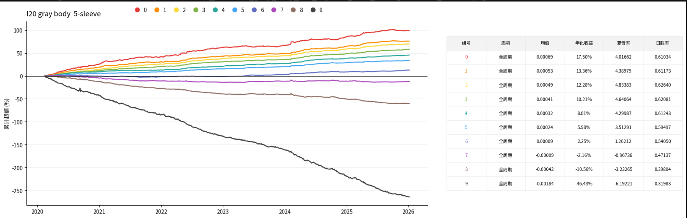
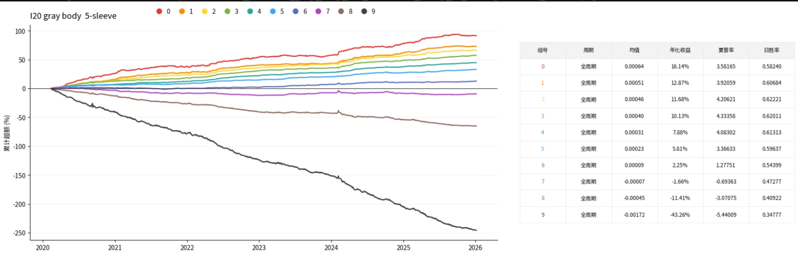
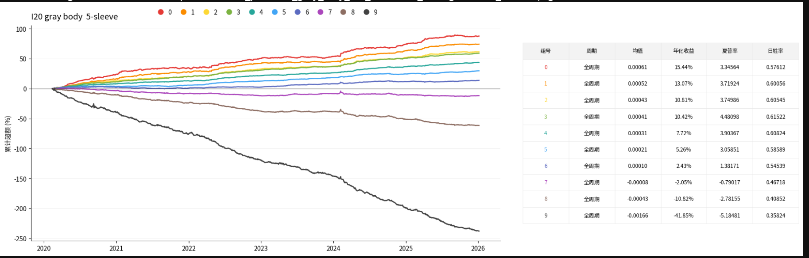
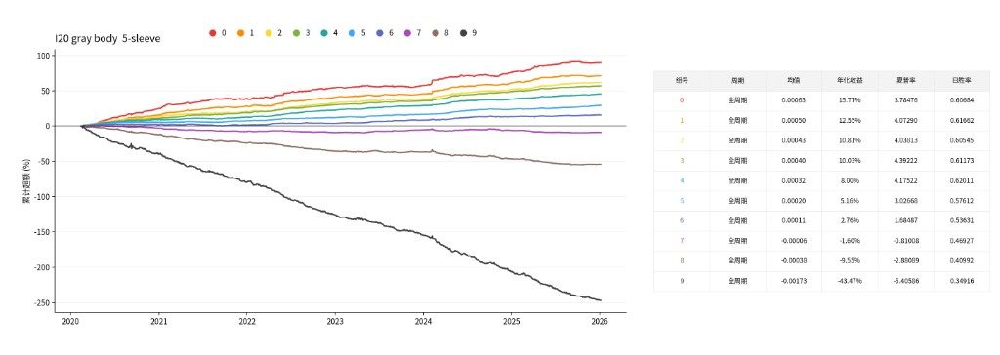

# 灰度 K 线图像回归（I20 / I60）

用日频灰度蜡烛图预测未来 5 个交易日相对 688 平权的超额收益，再按预测超额做每日选股和 5 个组合的回测。

当前工作区为第四轮实验：**分层卷积版**。以第二轮“纯 MSE + 随机取样 + 日均 Rank IC 选模”为基线，只调整 I20 的逐层卷积步长和填充。保留含 MACD 图像、时间注意力、三个种子、每种子十轮、学习率及五批资金回测。2026-10-16 用户提供公司平台结果并确认实际运行的是 MSE、步长 1/2/2、纵向 padding 2 的分层卷积版。

本轮 Top10% 扣费前年化超额 **17.50%**、图中夏普 **4.01662**、日胜率 **61.034%**，相对第二轮日均 Rank IC 基线分别提高 **1.36 个百分点、0.43497、2.794 个百分点**。这是目前已提供各版截图中 Top10% 收益与夏普最高的一版；逐年、分种子和显著性尚未验证，不能仅凭汇总图认定改善稳定。



完整十组结果、版本核对和解释见 [操作与实验记录](I20实验操作与结果记录_2026-10-14.md) 第 16 节。原图按字节保存，SHA256 为 `9c1c3f7d82db0bf03e728e523cf763396780b85f92b19257c99a84a46a8bb841`。

第二轮 Top10% 扣费前年化超额为 **16.14%**，图中夏普 **3.58165**，日胜率 **58.240%**；相对上一轮三种子整体 Spearman 分别提高 **0.70 个百分点、0.23601、0.628 个百分点**。收益超过最初单种子的 15.77%，夏普仍低于其 3.78476。完整十组数据和当时的方案见 [日均 Rank IC 历史分析](docs/I20_daily_rank_ic_result_20261014.md)。

第三轮“同日排序增强版”截图的 Top10% 年化为 **14.80%**、图中夏普 **3.18882**、日胜率 **58.101%**，相对第二轮分别下降 1.34 个百分点、0.39283、0.139 个百分点。该轮同时改变损失和取样，不能单独归因于损失函数。第四轮回到第二轮训练设定，检验卷积结构假设，因此主要对照应是第二轮，不能将第四轮相对第三轮的全部提升归因于卷积。



第二轮“纯 MSE + 日均 Rank IC 选模”代码归档在 [8e4562d](https://github.com/chensi-wei/change-rgb-i20/commit/8e4562dc23ad52105ffefbd5b6737995a6232cf4)，结果数值归档在 [a60edc5](https://github.com/chensi-wei/change-rgb-i20/commit/a60edc58eea140f6bcb14b9ed2b62389a3d2774e)，原图归档于 `3d7a00f`。本次在其后归档第四轮代码、配置和结果，不覆盖历史提交。复现第二轮应使用对应提交的整套文件。

归档核对发现本地 config.yaml 曾恢复为旧 RankNet 配置，与分层卷积代码和说明不一致。经用户明确确认平台实际运行参数，本次将本地配置恢复为该分层卷积方案及其独立输出目录。版本对应依据为用户确认，未取得平台配置快照、权重或运行 Git SHA 进行独立验证。

## 图像

本轮复用已有图像，图像根目录为：

```text
/storage/server/144server/cq/ChenSiwei/k_pictures_gray_body_i20_attention_v1/
```

图像在该目录下的 `I20/`（或 `I60/`）。无需再次运行 03。本轮权重、预测、日志和图表单独写入：

```text
/storage/server/144server/cq/ChenSiwei/k_pictures_gray_body_i20_layered_conv_v1/
```

主权重在 `models/{I20|I60}/seed_k.pt`；原整体规则的对照权重在 `models/{I20|I60}/pooled_spearman/seed_k.pt`。默认预测和回测结果在 `results/`，日志和图表在 `logs/`、`figures/`。原图片目录、上一轮权重和结果均保留。

本地图像备用目录与定位文件仍在 `data/images/i20_attention_v1/`。服务器权重和预测目录不可写时，回退到新的本地 `models/i20_layered_conv_v1/` 和 `results/i20_layered_conv_v1/`。实际路径以笔记本输出为准。

每个窗口目录里有：

| 文件 | 内容 |
|---|---|
| `images.npy` | `uint8`，形状 `(N, 1, H, W)`，NCHW |
| `labels.parquet` | 与图像行对齐的标签 |
| `image_spec.json` | 高度、宽度、通道和面板行数 |

`I20` 是 20 根日 K，宽 60，形状 `(N, 1, 100, 60)`。`I60` 是 60 根日 K，宽 180，形状 `(N, 1, 100, 180)`。高度固定 100，不缩放，不使用 JPEG。每根 K 线占 3 列像素。

画面分三块，背景为黑。灰度值：

- 上面 70 行是价格。收盘高于开盘的实体为 255，收盘低于或等于开盘的实体为 96。开盘到收盘的实体涂满这 3 列。最低到最高的影线只画在中间列，灰度为 176。没有均线。
- 中间 15 行是成交量，只画中间列。阳线对应 220，阴线对应 48，和实体的灰度不同。
- 下面 15 行是 MACD。EMA 12/26，信号线 9。计算时带上窗口之前最多 105 根收盘做预热，只把窗口内这一段画出来。DIF 为 200，只落在每根 K 线的左列。DEA 为 140，只落在右列。柱画在中间列，大于等于 0 为 255，小于 0 为 64。顶点不连成横穿其他列的线，避免盖住柱。DIF、DEA 和柱一起按窗口内最大绝对值缩放到这 15 行里。

价格先把窗口第一根收盘当作锚，在收益率路径上重建 OHLC，再用窗口内 OHLC 的最小最大值归一化。MACD 用同一条收益率路径，锚点收盘为 1。样本是每个交易日一张图。

生成在 `03_generate_images.ipynb`。`WINDOW_KEY` 用 `20` 或 `60`。当前默认 `MAX_CODES = None` 生成全量；调试时可改成 `20`，调试完成后须重新生成全量再训练。

## 标签与样本过滤

`labels.parquet` 的列：

| 列 | 含义 |
|---|---|
| `code`、`date` | 股票和调仓日 t |
| `stock_ret` | t 之后 5 个交易日的个股收益，`prod(1+r)-1` |
| `mkt_ret` | 同期 688 平权的 5 日收益。日收益来自 `pingquan.csv` 的 `688` 列，单位由百分数换成小数 |
| `future_ret` | `stock_ret - mkt_ret`，回归的目标 |
| `label` | `future_ret > 0` 为 1，否则为 0。本仓库训练时不使用这一列 |
| `split` | `train`、`valid`、`test` 或 `ignore` |

过滤与 `no_rolling` 相同，在生成图像时完成：

- 只保留 `universe.parquet` 里 `eligible` 的股票。
- 窗口在 t 之前必须凑满，t 之后必须还有 5 个交易日。
- 上市缓冲 1 根：窗口起点不能落在该股票行情的第一根上。
- 调仓日 t 涨停或跌停的样本去掉。窗口内部的涨跌停保留，也不要求 t+1 非涨停。
- 从窗口第一天到 t+5，只要有一天 ST，整段去掉。
- 这段日期在全市场日历上的跨度大于 `窗口 + 5` 时，视为中间有停牌，去掉。
- 窗口内成交量，以及 t+1 到 t+5 的个股收益和 688 收益，都必须是有限数。

划分按时间，训练和验证之间、验证和测试之间各空出 `窗口` 个交易日，避免同一段 K 线同时出现在两个集合里：

- 2015-01-01 到 2019-12-31 为训练加验证，按日期取前 70% 做训练。
- 空出窗口长度后再做验证。
- 再空出同样长度，并且不早于 2020-01-01，直到 2025-12-31 为测试。
- 落在两段空档里的样本标记为 `ignore`。图像仍在 `images.npy` 里，训练和预测都不读它们。

行情面板在 `/home/shixi05/ChenSiwei/0914/data/processed`。688 平权在 `/storage/server/227server/marketdata/pingquan/daily/pingquan.csv`。

## 模型

每块仍为无偏置卷积、BatchNorm、LeakyReLU（负斜率 0.01）和 MaxPool。仅 I20 改为逐层步长和填充；I60 保留原四层结构。核、步长、填充均按“高、宽”排列。

| 参数 | 原 I20 / 第二轮 | 本轮 I20 | I60（保留） |
|---|---|---|---|
| 输入 | `(1,100,60)` | 相同 | `(1,100,180)` |
| 通道 | 64, 128, 256 | 相同 | 64, 128, 256, 512 |
| 每层卷积核 | `(5,3)` | 相同 | `(5,3)` |
| 卷积步长 | 三层均 `(3,1)` | `(1,1)、(2,1)、(2,1)` | 四层均 `(3,1)` |
| 卷积填充 | 三层均 `(12,1)` | 三层均 `(2,1)` | 四层均 `(12,1)` |
| 池化核 / 步长 | `(2,1) / (2,1)` | 相同 | 相同 |
| 各块池化后高度 | 20 → 7 → 4 | 50 → 12 → 3 | 20 → 7 → 4 → 4 |

原第三层输入高度为 7、纵向填充为 12，其池化前 9 行卷积输出中，有 5 行的卷积窗口完全落在零填充区域；这是几何核对结果，不等于已证明收益下降原因。新配置减少填充，并在第一层保留更多纵向细节，再逐层压缩。横向仍不降采样、不使用扩张卷积。

卷积之后仍经过时间注意力、展平、Dropout 0.5，再由线性层输出一个数。注意力沿高度取均值，用核宽 3 的一维卷积为历史列打分；softmax 权重乘列数后与等权按 1:1 混合，初始等权。卷积和线性层继续使用 Xavier uniform 初始化。

按配置计算，I20 卷积乘加量从每样本 370,944,000 变为 367,027,200，约为原来的 98.94%；这里不含池化、归一化、注意力和反向传播。展平维数从 61,440 变为 46,080，总可训练参数从 678,466 变为 663,106。前层特征图更大，因此不能据此承诺显存或训练时间不增加。

训练目标恢复为标准化目标上的纯 MSE，取样恢复为全训练集随机打乱。目标仍先按训练集 1% / 99% 分位截尾，再用训练集截尾后均值、标准差标准化；推理还原到原超额尺度。配置为 `cnn.loss: mse`。此前的排序损失实现保留在原文件中，但本轮不启用；没有加入 Huber 或其他新损失。

`cnn.model_spec` 解析实际逐层参数并计算特征图尺寸，训练与预测均使用同一配置。它兼容原先“所有层共用一个整数对”的配置，也支持按 I20 / I60 分别配置。所有新权重保存完整 `model_spec`，跳过训练和预测时检查匹配，防止旧权重混入。

## 训练

在 `04_train_predict.ipynb` 里运行。优化器是 Adam，学习率固定 `1e-5`，没有学习率衰减，也没有早停。每个种子固定 10 个 epoch。主权重留下验证集日均 Rank IC 最高的一轮：每天对预测值与未截尾 `future_ret` 计算 Spearman，再对有效日期等权平均。并列值使用平均秩；少于 3 只股票或分数/目标为常量的日期不计入，并记录有效日期数。没有有效日期时明确报错，不静默改用最后一轮。

同一训练过程还保留原整体 Spearman 指标最高的一轮，只增加指标计算和权重保存，不额外训练一遍。原整体指标的双 argsort 实现保持不变，以复现上一轮选模方式；新日内指标使用标准平均秩。两套候选都只使用验证集，测试集不参与选模。

训练集仍使用全部原本可训练的 `split == train` 样本，不做类别或收益下采样。像素均值和标准差在训练索引上抽 2 万张图估计，是一个标量。I20 的训练 batch 是 64，I60 是 32；`num_workers=0`，`pin_memory=False`。

本轮使用原随机 DataLoader：`shuffle=True`，保留末尾不足一批的样本。排序损失与同日分组取样关闭。实际耗时和显存使用量须由公司平台观察。

每轮仍打印训练/验证 mse、方向正确率、`pooled_ic`、`daily_ic`、有效日期数和 `epoch_s`。`daily_ic` 决定主模型。`loss_z` 为标准化目标上的 MSE，沿用的 `rank`、`pairs` 和有效 `rank_batches` 计数为零。权重保留完整 history、主/对照选模指标、最佳轮次、损失及取样配置，并增加实际逐层 `model_spec`。验证不建梯度图。

固定 `N_SEEDS=3`，随机种子为 `20260417`、`20260418`、`20260419`，每种子固定 10 轮。只有主/对照权重都完整，且模型结构、损失/取样、训练 batch、选模规则、种子和轮数匹配时才跳过已有种子。预测同样检查结构、损失/取样、选模规则、种子和轮数。缺少结构记录的旧版权重会报错；复现旧实验须使用对应版本的整套代码和配置。

每轮 `seed_k.running.pt` 保存当时主指标最好的权重，仍不支持断点续训；中断后该种子从头开始。对照最终权重先保存，再保存主最终权重；完成后删除 running 文件。

权重目录：

```text
/storage/server/144server/cq/ChenSiwei/k_pictures_gray_body_i20_layered_conv_v1/models/{I20|I60}/
```

## 预测与回测

`predict_window` 只对 `test` 做推理，写出

```text
/storage/server/144server/cq/ChenSiwei/k_pictures_gray_body_i20_layered_conv_v1/results/pred_{I20|I60}.parquet
```

`pred` 是预测的 5 日超额，可以是负数。它和二分类版本的 `prob` 不是同一个量。`prob` 是“超额大于 0”的概率，范围在 0 到 1。两边选股时都是当天分数从高到低取前 10%。

默认预测恰好读取三个主权重，不递归扫描对照子目录。可用 `predict_window(..., selection="pooled_spearman")` 对三个旧规则候选做额外推理，结果单独写为 `pred_I20_pooled_spearman.parquet`，不覆盖主预测。该选项只增加推理，不增加训练；05 默认仍使用主结果。该对照同样来自本轮分层卷积模型的 MSE 训练，只改变选模规则，并非第二轮旧卷积结构的权重。对照供报告使用，不能根据测试结果反向选择规则。

样本外还会打印 mse、方向正确率和 `pred` 与 `future_ret` 的相关系数。

`05_plot_top10.ipynb` 的回测与 `no_rolling` 的 5 个组合相同：

- 每个交易日按 `pred` 取最高 10%，等权。
- t 收盘买入，t+5 收盘卖出。资金分成 5 批，卖出所得再投入当天的新篮子，各批净值独立复利。
- 组合超额是当天各批超额相对 688 平权的净值加权平均。不满 5 批的日期不计入。
- 十分位、随机 10 组使用同一套盯市。
- 成本图按每边 5 个基点，在换仓时按单边换手的两倍扣除。十分位图本身不扣费。

## 信息边界

本轮结构只处理原有历史图像，没有新增未来输入、标签输入或跨样本时间信息。截尾和标准化只使用训练集，验证集用于选轮次；五日监督标签、数据划分及交易日隔离沿用原代码。已查看的 2020–2025 测试结果会影响研究方向，因此后续在同一区间的改善只能作为迭代证据，不能当作全新未见数据上的独立验证。

这不等于整个原框架通过了无前视审计：原持有期 ST/停牌筛选、未来收益缺失样本过滤及 t 日完整图片配合 t 收盘成交的时点问题按用户要求保留，详见操作记录第 7 节。

## 如何运行

复现时使用本次分层卷积结果归档提交的整套项目，确保 `cnn.py`、`train_lib.py`、`config.yaml`、`04_train_predict.ipynb` 和 `05_plot_top10.ipynb` 来自同一版本。放到公司平台单独的项目目录，避免覆盖其他正在运行的版本。

1. 本轮直接复用上一轮完整图像；不要重新生成或覆盖输入。若尚未生成完整图片，才运行 03 的 `MAX_CODES=None`。
2. 重启内核，运行 `04_train_predict.ipynb`：确认 `loss=mse`、`sampler=random`、`select=daily_rank_ic`，`images` 指向 `k_pictures_gray_body_i20_attention_v1`，`output` 指向 `k_pictures_gray_body_i20_layered_conv_v1`。I20 打印的 `block_hw` 应为 `[[50,60],[12,60],[3,60]]`。训练完三个种子后运行预测格，确认写出 `pred_I20.parquet`。
3. `05_plot_top10.ipynb`：Top 10%、十分位、随机分组、扣费对照。

`WINDOW_KEY` 用 `"I20"` 或 `"I60"`，必须和已经生成的图一致。不要和正在读同一份 `images.npy` 的另一个训练同时跑，两边会抢网络盘。

主机内存约 62 GB，放不下整份 `images.npy`。训练使用内存映射，不要把整个数组读进内存。

## 仓库里没有的文件

`.gitignore` 排除了图像、权重、预测和日志。这些文件留在 144 和服务器本机目录里：

```text
*.npy  *.pt  *.parquet
data/  models/  results/  figures/  logs/
```

## 上一轮 I20 时间注意力实验结果（3 个种子，整体 Spearman 选模）

2026-10-13 用户提供的公司平台运行结果：I20，含 MACD，2020–2025，五批资金，扣费前，三个种子等权平均。以下数值摘自结果图，未在本地重跑。组别 0 是预测最高的 10%，组别 9 是最低的 10%。年化超额使用日均超额乘以 252；累计超额是日超额累加。



| 组别 | 年化超额 | 夏普率 | 日胜率 |
|---|---|---|---|
| 0 | 15.44% | 3.34564 | 57.612% |
| 1 | 13.07% | 3.71924 | 60.056% |
| 2 | 10.81% | 3.74986 | 60.545% |
| 3 | 10.42% | 4.48098 | 61.522% |
| 4 | 7.72% | 3.90367 | 60.824% |
| 5 | 5.26% | 3.05851 | 58.589% |
| 6 | 2.43% | 1.38171 | 54.539% |
| 7 | -2.05% | -0.79017 | 46.718% |
| 8 | -10.82% | -2.78155 | 40.852% |
| 9 | -41.85% | -5.18481 | 35.824% |

与原含 MACD、单种子的 Top10% 结果比较：

| 指标 | 原模型，1 个种子 | 时间注意力，3 个种子 | 变化 |
|---|---|---|---|
| 年化超额 | 15.77% | 15.44% | -0.33 个百分点 |
| 夏普率 | 3.78476 | 3.34564 | -0.43912 |
| 日胜率 | 60.684% | 57.612% | -3.072 个百分点 |

本次实验未改善 Top10% 扣费前收益与夏普率。模型与种子数同时变化，不能仅据这两张结果图归因于注意力层。当前保留代码和结果作为实验记录，不将其表述为已经验证的改进。

## 原 I20 十分位（1 个种子）

1 个种子，2020–2025，5 个组合，扣费前。组别 0 是预测超额最高的 10%。



## I60 十分位


